# Database Diagram — ADHD Budgeting App (MVP #1)

Source: the schema in [database-design.md](database-design.md) (itself from the Technical
Architecture spec — Database Architecture, and the ADRs). GitHub renders the Mermaid block below
as a picture.

`AUTH_USERS` is Supabase's built-in `auth.users` table (not created by our migration); every table
is owned through it. `error_events.user_id` is nullable (a pre-sign-in crash has no user) — shown
as an optional link.

```mermaid
erDiagram
    AUTH_USERS ||--|| profiles : "has profile"
    AUTH_USERS ||--o{ deposit_schedules : owns
    AUTH_USERS ||--o{ deposits : owns
    AUTH_USERS ||--o{ bills : owns
    AUTH_USERS ||--o{ bill_payments : owns
    AUTH_USERS ||--o{ spending_entries : owns
    AUTH_USERS ||--o{ set_aside_items : owns
    AUTH_USERS ||--o{ reminders : owns
    AUTH_USERS ||--o{ check_ins : owns
    AUTH_USERS ||--o{ error_events : "owns (optional)"

    deposit_schedules ||--o{ deposits : "scheduled as"
    bills ||--o{ bill_payments : "paid via"
    bills ||--o{ reminders : "reminded by"
    spending_entries ||--o{ spending_entries : "refunded by"

    AUTH_USERS {
        uuid id PK
    }

    profiles {
        uuid id PK "= auth.users.id"
        text display_name
        text time_zone
        time default_reminder_time
        int opening_balance_cents "negative allowed"
        int flex_buffer_cents ">= 0"
        date last_active_date
        timestamptz created_at
        timestamptz updated_at
    }

    deposit_schedules {
        uuid id PK
        uuid user_id FK
        text name
        int amount_cents "> 0"
        text frequency "one_time|weekly|biweekly|semimonthly|monthly"
        date anchor_date
        smallint second_day "semimonthly only"
        text status "active|paused"
        timestamptz created_at
        timestamptz updated_at
    }

    deposits {
        uuid id PK
        uuid user_id FK
        uuid schedule_id FK "nullable; SET NULL"
        int amount_cents "> 0"
        date deposit_date
        timestamptz created_at
        timestamptz updated_at
    }

    bills {
        uuid id PK
        uuid user_id FK
        text name
        int amount_cents "> 0"
        text kind "bill|subscription"
        text frequency "one_time|weekly|biweekly|semimonthly|monthly"
        date anchor_date
        smallint second_day "semimonthly only"
        smallint reminder_offset_days "nullable; >= 0"
        text status "active|paused"
        timestamptz created_at
        timestamptz updated_at
    }

    bill_payments {
        uuid id PK
        uuid user_id FK
        uuid bill_id FK
        date due_date
        date paid_on
        timestamptz created_at
    }

    spending_entries {
        uuid id PK
        uuid user_id FK
        int amount_cents "> 0"
        date entry_date
        text type "purchase|refund"
        uuid refunds_entry_id FK "nullable; self-link; refund only"
        text category
        text note
        timestamptz created_at
        timestamptz updated_at
    }

    set_aside_items {
        uuid id PK
        uuid user_id FK
        text name
        int price_cents "> 0"
        date added_on
        text outcome "pending|bought|let_go"
        timestamptz created_at
        timestamptz updated_at
    }

    reminders {
        uuid id PK
        uuid user_id FK
        uuid bill_id FK
        date due_date
        timestamptz send_at
        text status "pending|sent|failed"
        int tries ">= 0"
        timestamptz created_at
        timestamptz updated_at
    }

    check_ins {
        uuid id PK
        uuid user_id FK
        date check_in_date
        smallint calm_rating "nullable; 1-5"
        timestamptz created_at
    }

    error_events {
        uuid id PK
        uuid user_id FK "nullable"
        timestamptz occurred_at
        text type "failed_reminder|failed_save|user_reported|screen_crash"
        text screen
    }
```

## Unique constraints (not shown in the diagram)
- `bill_payments`: `UNIQUE (bill_id, due_date)` — one payment record per bill occurrence.
- `reminders`: `UNIQUE (bill_id, due_date)` — idempotent sending (ADR-0015).
